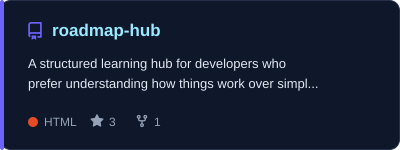
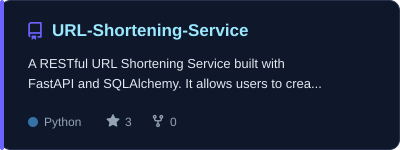
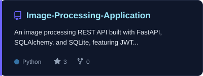
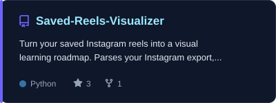

### Understanding Software. Building Solutions. Growing as an Engineer.

Hi, I'm Samiullah, a Computer Science student exploring software engineering, backend development, and artificial intelligence. I enjoy learning how technology works under the hood, strengthening my fundamentals, and applying what I learn through practical projects.

---

## About Me

I'm a Computer Science student interested in understanding how software works beyond just writing code.

I'm building my foundation in software engineering by learning core concepts such as data structures and algorithms, databases, computer networks, operating systems, and software architecture. I enjoy understanding how things work under the hood and how different parts of a system fit together.

Alongside the fundamentals, I'm exploring backend development and AI. I enjoy building practical projects with Python, FastAPI, SQL and PostgreSQL, while learning how AI works and how it can be used to solve real-world problems.

I believe becoming a good engineer is about more than knowing tools or frameworks. It's about understanding problems, thinking critically, making thoughtful decisions, and continuously learning how to build better software.

## What I'm Focused On

- **Software Engineering Fundamentals:** Building a strong understanding of data structures and algorithms, operating systems, computer networks, databases, and software architecture.
- **Backend Development:** Understanding how servers, APIs, authentication, and databases work under the hood.
- **Artificial Intelligence:** Exploring AI concepts and learning how AI can be used to solve real-world problems.
- **Database Engineering:** Improving my SQL and PostgreSQL skills, including database design, queries, and transactions.
- **Practical Projects:** Applying what I learn by building projects, experimenting with technologies, and improving my problem-solving skills.
- 

---

## Tech Stack

**Languages**

**Backend and Databases**

**Tools and Environment**

---

## Featured Projects

---

## GitHub Activity

<table>
<tr>
<td width="50%" align="center">

</td>
<td width="50%" align="center">

</td>
</tr>
<tr>
<td width="50%" align="center">

</td>
<td width="50%" align="center">

</td>
</tr>
</table>

---

### Let's Connect

I'm open to learning from others, collaborating on projects and taking on meaningful backend work.

If you'd like to talk, you can reach me by [email](mailto:qwertynoob456@gmail.com) or on [X](https://x.com/khan_sami88006).

 

