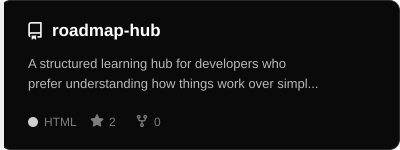
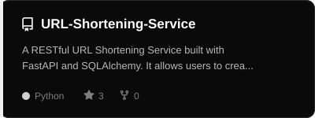
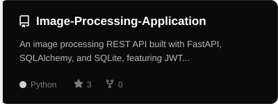
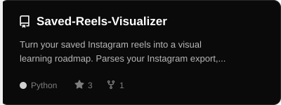

  <b>Hi, I'm Samiullah</b> — a Computer Science student exploring <b>software engineering</b>, 
  <b>backend development</b> and <b>artificial intelligence</b>.

  
  
  
  
  

## About Me

I'm a Computer Science student interested in understanding how software works **beyond just writing code**.

I'm building my foundation in software engineering — data structures and algorithms, databases, computer networks, operating systems and software architecture — and I enjoy seeing how the different parts of a system fit together.

Alongside the fundamentals, I'm exploring backend development and AI, building practical projects with **Python, FastAPI, SQL and PostgreSQL**.

For me, being a good engineer isn't about knowing tools or frameworks. It's about understanding problems, thinking critically, making thoughtful decisions and continuously learning to build better software.

## Current Focus

| Area | Details |
|:--|:--|
| **Engineering Fundamentals** | DSA, operating systems, networks, databases and software architecture |
| **Backend Development** | How servers, APIs, authentication and databases work under the hood |
| **Artificial Intelligence** | Learning AI concepts and applying them to real-world problems |
| **Database Engineering** | SQL & PostgreSQL — schema design, queries and transactions |
| **Practical Projects** | Turning what I learn into working software |

## Tech Stack

**Languages**

**Backend & Databases**

**Tools & Environment**

## Featured Projects

&nbsp;

&nbsp;

## GitHub Stats

  
&nbsp;

## Get in Touch

I'm open to learning from others, collaborating on projects and taking on meaningful backend work.

&nbsp;

